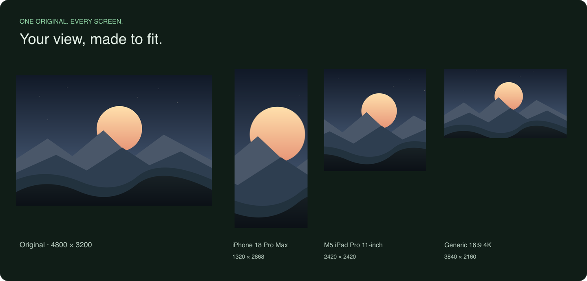
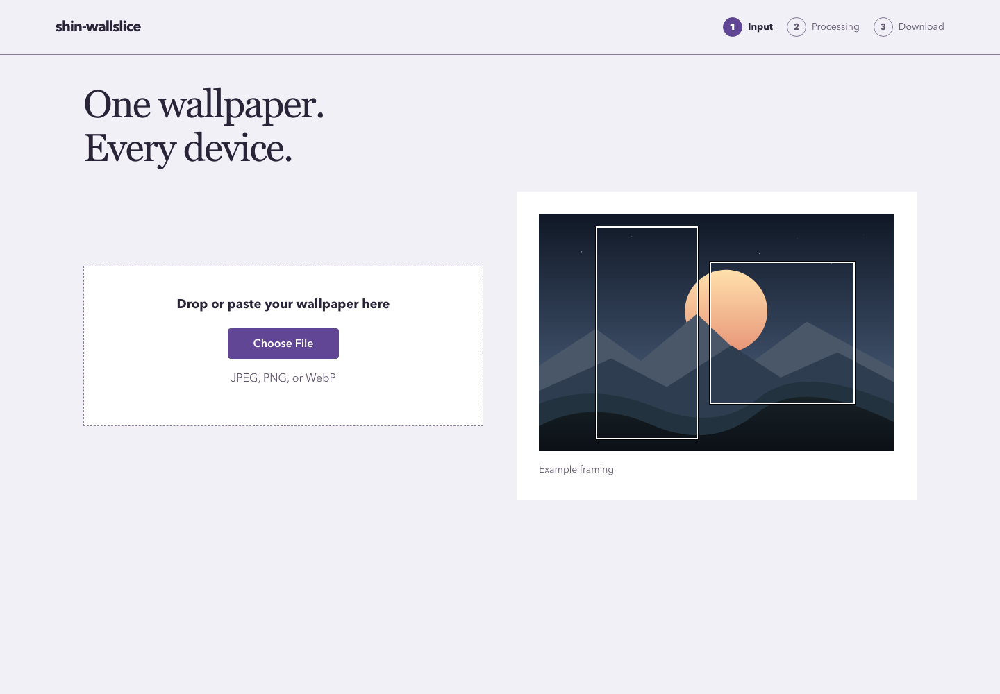
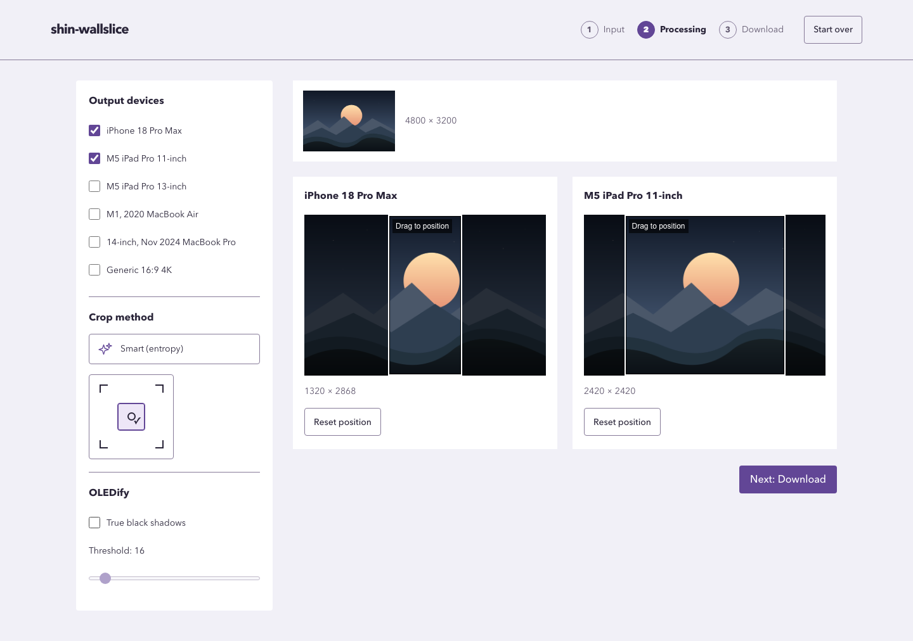
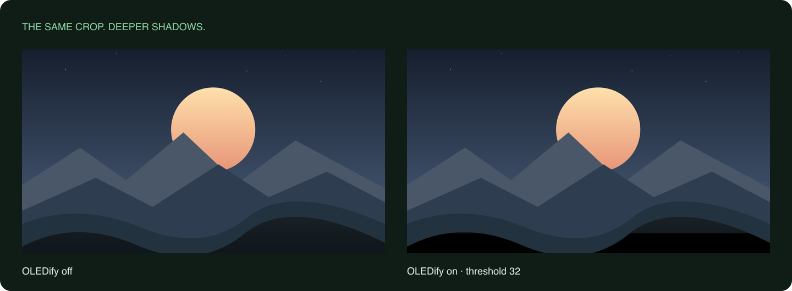
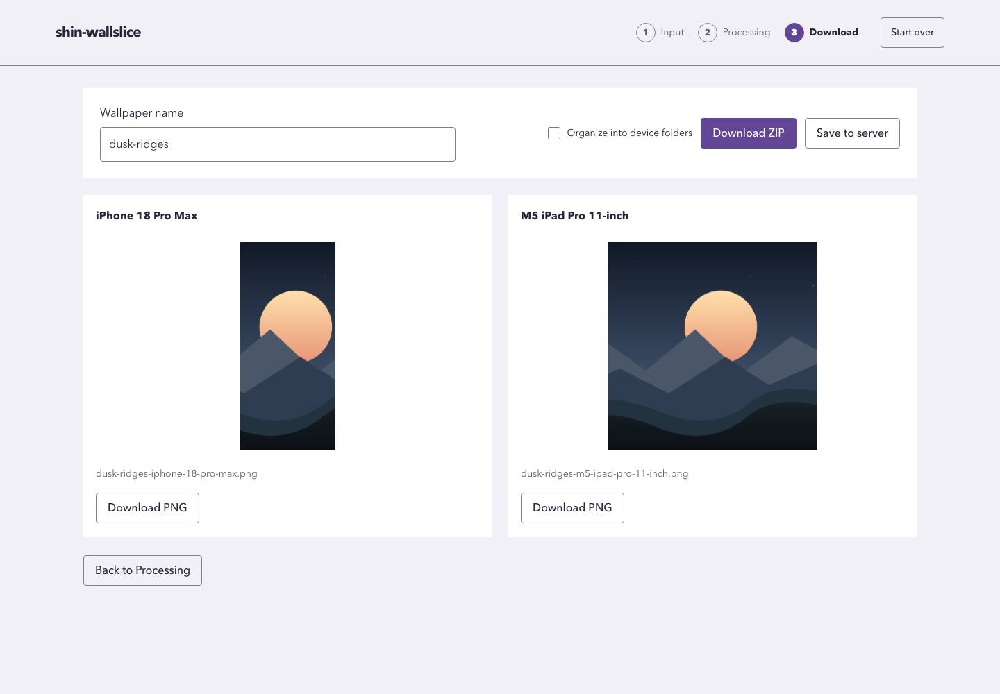

<div align="center">

# shin-wallslice

**One wallpaper. Every device.**

Turn a favorite image into wallpapers that fit your phone, tablet, and computer.<br>
Frame each crop, deepen the shadows, and download or save the results to your server.

[Get started](#get-started) · [See the workflow](#your-first-wallpaper) · [Configure](#configuration) · [Get help](#troubleshooting)

</div>



_[View the comparison full size](docs/images/device-outputs.png). One original, three shapes. These are real PNG exports from shin-wallslice using center crops. [Download the example source](docs/images/dusk-ridges.png) to try it yourself._

shin-wallslice runs on your own server in a single container. Cropping and exports use local image processing; no account, database, or second container is required. Optional AI can suggest names and frame a detected subject through a vision service you configure.

- **Fit your screens:** six bundled device presets, independent crop positioning, and exact output dimensions.
- **Choose your framing:** local Smart (entropy), five anchors, or optional Smart (AI), with pointer, touch, and keyboard adjustments.
- **Make shadows black:** OLEDify turns near-black pixels into true black with an adjustable threshold.
- **Take the results:** lossless PNGs individually or in a ZIP, optionally organized into device folders. Configure an output directory to save the same files directly to your server, with confirmation before replacement.
- **Feel at home:** automatic light/dark appearance and preferences remembered on your server.

## Contents

- [Get started](#get-started)
  - [Docker run](#docker-run)
  - [Docker Compose](#docker-compose)
  - [Manual Unraid setup](#manual-unraid-setup)
  - [Local Node.js](#local-nodejs)
- [Your first wallpaper](#your-first-wallpaper)
- [Devices and output sizes](#devices-and-output-sizes)
- [Configuration](#configuration)
- [Optional AI](#optional-ai)
- [Memory, storage, and limits](#memory-storage-and-limits)
- [Persistence and privacy](#persistence-and-privacy)
- [Updates, backups, and removal](#updates-backups-and-removal)
- [Troubleshooting](#troubleshooting)
- [Development and verification](#development-and-verification)

## Get started

### Choose an installation

**Unraid:** [import the supplied template and Apply](docs/unraid.md). Community
Applications listing is pending. No source checkout or build is needed.

**Install version 1.2.0** for Linux amd64 and arm64. The
commands below install it without registry login. See the
[release](https://github.com/jmdarling/shin-wallslice/releases/tag/v1.2.0) and
[1.2.0 changes](docs/maintainers/v1.2.0-release-notes.md). The release records the
exact digest, native runtime checks, SBOM/provenance, and vulnerability reports.

Allow **4 GiB application RAM** and **4 GiB free writable temporary disk**. One
image supports Linux amd64 and arm64. Ordinary processing works without AI or
another service container; optional AI is disabled by default.

**Access:** single-user shared preferences, no built-in login. Use a trusted LAN.
For remote access provide your own authentication/HTTPS layer or private VPN.
Terminal examples use POSIX shell syntax.

### Docker run

Install Docker, then run on your server (no Git, Node.js, checkout, build, or
registry login required for the public image):

```sh
docker run -d \
  --name shin-wallslice \
  --restart unless-stopped \
  --memory=4g \
  -p 8080:3000 \
  --mount type=volume,src=shin-wallslice-data,dst=/data \
  ghcr.io/jmdarling/shin-wallslice:1.2.0
```

Open [http://localhost:8080](http://localhost:8080), or
`http://YOUR_SERVER_IP:8080` from another device (replace `YOUR_SERVER_IP` with the
server's LAN address). The Input screen should appear. Named volumes initialize
with the non-root UID/GID 1000 application's ownership.

```sh
curl --fail http://localhost:8080/api/health
docker inspect --format '{{.State.Health.Status}}' shin-wallslice
docker logs --tail 50 shin-wallslice
```

Expect `{"status":"ok"}` and `healthy` after the first health check, usually within
30 seconds. Change only the host port for a conflict, e.g. `-p 8081:3000`. Persistent
preferences survive container replacement with the same volume; temporary images do
not. Continue with [Your first wallpaper](#your-first-wallpaper).

### Docker Compose

Download [compose.yaml](compose.yaml) to an otherwise empty directory; no checkout
is needed. Its contents are:

```yaml
services:
  wallslice:
    image: ghcr.io/jmdarling/shin-wallslice:1.2.0
    container_name: shin-wallslice
    restart: unless-stopped
    mem_limit: 4g
    ports:
      - '8080:3000'
    volumes:
      - wallslice-data:/data

volumes:
  wallslice-data:
```

In that directory:

```sh
docker compose config
docker compose pull
docker compose up -d
docker compose ps
curl --fail http://localhost:8080/api/health
docker compose logs --tail 50 wallslice
```

Open [http://localhost:8080](http://localhost:8080) or your server's LAN address.
Use one installation method at a time; both examples use the same name and port.
Compose creates a project-scoped volume; retain the same directory/project name for
replacement (`docker compose -p YOUR_PROJECT` can fix a chosen project name).
Change `8080:3000` to `8081:3000` for a port conflict. `docker compose down` removes
the container/network while retaining preferences; `--volumes` also deletes them.

Optional read-only partial JSON: first create a readable private file, then add
`./config.json:/config/config.json:ro` alongside the data mapping. No JSON is needed
for first run. See [Configuration](#configuration).

### Manual Unraid setup

Use the [supplied template and short Unraid 7.2.3 guide](docs/unraid.md). It covers
pre-listing import, port/path choices, WebUI, autostart, advanced AI/JSON settings,
updates, rollback, and the real-NAS verification checklist. No image build, XML
editing, or terminal permission repair is needed. Fastify runs as UID/GID 1000;
the template's bounded initializer prepares only the dedicated appdata mount.

### Local Node.js

Install [Node.js 24 LTS](https://nodejs.org/en/download) and Git. Confirm `node --version` reports `v24.x`, then install the pinned package manager and build:

```sh
npm install --global pnpm@11.25.0
git clone https://github.com/jmdarling/shin-wallslice.git
cd shin-wallslice
pnpm install --frozen-lockfile
pnpm build
pnpm start
```

Keep that terminal open. Browse to **[http://localhost:3000](http://localhost:3000)**. Fastify serves the client and API through one Node.js process and one port. In a second terminal, `curl --fail http://localhost:3000/api/health` should return `{"status":"ok"}`. Stop with **Ctrl+C**; run `pnpm start` again from the repository root to restart. For unattended operation, manage this foreground command with your host's service manager, or use the container installation.

Local defaults bind to `0.0.0.0` and store preferences in `packages/server/data/` and temporary files in `packages/server/tmp/` when launched through these pnpm commands. These paths are ignored by Git. A private [config/local.json](#configuration) may change them. To use a different port on a POSIX shell:

```sh
SHIN_WALLSLICE_PORT=3100 pnpm start
```

In PowerShell, set `$env:SHIN_WALLSLICE_PORT = '3100'` before `pnpm start`. Open the matching port. Browser test tools are needed only for [development verification](#development-and-verification), not to run production.

## Your first wallpaper

Screenshots follow your light/dark preference where supported. Open a full-size capture for detail: [Input](docs/images/input-light.png) · [Processing](docs/images/processing-light.png) · [Download](docs/images/download-light.png).

### 1. Choose an image

<picture>
  <source media="(prefers-color-scheme: dark)" srcset="docs/images/input-dark.png">
  
</picture>

Select **Choose File**, drop one image onto the page, or paste a copied image while on Input. Accepted formats are **still JPEG, PNG, and WebP**. Animated images are rejected. Paste requires an actual image on the clipboard; a copied URL or file reference may not contain image data. File selection is always an alternative.

Choose a source with enough resolution for your largest output. Orientation is normalized before cropping. At default settings the decoded limit is about **56 megapixels**, including 7680 × 4320 and 8192 × 4320; the upload byte limit is **512 MiB**. A compressed file's size alone does not indicate whether its decoded pixels will fit.

### 2. Frame each screen

<picture>
  <source media="(prefers-color-scheme: dark)" srcset="docs/images/processing-dark.png">
  
</picture>

Select output devices in the left panel (above the previews on mobile). The header marks the current stage. Every crop has a fixed size and aspect ratio; position it to choose which part of the source to keep.

| Control                      | What it does                                                                                          |
| ---------------------------- | ----------------------------------------------------------------------------------------------------- |
| Smart (entropy)              | Finds a visually detailed region locally, separately for each device. No AI needed.                   |
| Smart (AI)                   | Uses a detected main subject when AI is enabled. Entropy previews remain usable while detection runs. |
| Corner / center selector     | Positions crops at top-left, top-right, center, bottom-left, or bottom-right.                         |
| Drag a crop boundary         | Moves only that device's crop; touch dragging works too.                                              |
| Arrow keys on a focused crop | Moves by one source pixel; hold Shift to move 10 pixels.                                              |
| Reset position               | Restores only that device to the current method's starting position.                                  |

**Changing the global method or anchor resets the positions of all selected devices.** Newly selected devices initialize from the current method. Crops stay inside the source and cannot be resized independently. A softness warning means that crop will be upscaled to reach the device's output dimensions.

First use selects entropy when AI is disabled and AI when enabled. An explicit entropy choice remains entropy after enabling AI. Saved legacy Smart choices migrate using AI availability; anchors retain their selection. If AI is disabled later, a saved AI choice resolves to entropy. See [AI behavior](#what-to-expect-from-ai) for pending results and manual-edit protection.

### 3. Optionally OLEDify the shadows

Enable **True black shadows** under **OLEDify** and move **Threshold** (0–255; default 16). A pixel becomes RGB `0, 0, 0` only when **all three RGB channels are at or below the threshold**, after resizing. Other pixels retain their RGB values. For example, at 32, `(20, 25, 30)` becomes black but `(20, 25, 40)` does not.



_[View the comparison full size](docs/images/oledify-comparison.png). Actual exports with identical framing, OLEDify off on the left and threshold 32 on the right. This is a pixel cutoff, not a global brightness adjustment; higher thresholds remove more shadow detail._

Previews update automatically. Wait for generation to finish before continuing or downloading. Exports use the same settings and framing as the final previews.

### 4. Name, download, or save

<picture>
  <source media="(prefers-color-scheme: dark)" srcset="docs/images/download-dark.png">
  
</picture>

Choose **Next: Download**, edit **Wallpaper name**, then choose **Download ZIP** for all outputs or **Download PNG** on an individual preview. The base name is normalized into a safe filename: slashes and unsupported characters become hyphens, leading/trailing dots or spacing are removed, length is capped at 100 characters, and an empty result becomes `wallpaper`.

For the name `Dusk Ridges`, individual files include `Dusk Ridges-iphone-18-pro-max.png`. ZIP organization changes only the archive's layout:

| Option                       | Example ZIP entries inside `Dusk Ridges.zip`                                  |
| ---------------------------- | ----------------------------------------------------------------------------- |
| Unchecked (default)          | `Dusk Ridges-iphone-18-pro-max.png` and `Dusk Ridges-m5-ipad-pro-11-inch.png` |
| Organize into device folders | `iphone-18-pro-max/Dusk Ridges.png` and `m5-ipad-pro-11-inch/Dusk Ridges.png` |

Individual PNGs always retain the device suffix. Install the downloaded file as wallpaper using your device's normal wallpaper settings; shin-wallslice does not change device settings remotely. Outputs have exact pixel dimensions, but a device may still apply its own zoom or placement.

**Back to Processing** preserves your current work. **Start over** discards the current image, positions, generated files, and edited name. Reload also starts at Input; only preferences survive. Appearance follows your browser/system light or dark preference, including changes while the app is open. There is no manual theme setting.

## Devices and output sizes

| Preset                        | Output pixels | Shape     |
| ----------------------------- | ------------- | --------- |
| iPhone 18 Pro Max             | 1320 × 2868   | Portrait  |
| M5 iPad Pro 11-inch           | 2420 × 2420   | Square    |
| M5 iPad Pro 13-inch           | 2752 × 2752   | Square    |
| M1, 2020 MacBook Air          | 2560 × 1600   | Landscape |
| 14-inch, Nov 2024 MacBook Pro | 3024 × 1964   | Landscape |
| Generic 16:9 4K               | 3840 × 2160   | Landscape |

Tablet outputs are intentionally square. You can use a preset on any device that suits its dimensions; model names identify the bundled presets rather than auto-detected hardware.

Custom devices are currently a source-level change. Edit [devices.json](packages/server/src/devices.json), add a unique lowercase hyphenated ID, display name, and positive integer width/height, then rebuild the app/image. Dimensions are capped at 16384 per side and the complete catalog must fit processing/storage budgets. There is no runtime custom-device editor or catalog override.

### Save wallpapers to your server

Server saving is optional and disabled by default, and requires version **1.2.0
or later**. Update an older installation before enabling it. Local source builds
can use `docker build -t shin-wallslice:local .` and substitute
`shin-wallslice:local` in the Docker command, Compose `image`, or Unraid Repository.

Set a partial JSON override (read-only mounts work):

```json
{
  "outputDirectory": "/data/output"
}
```

Or add `--env SHIN_WALLSLICE_OUTPUT_DIRECTORY=/data/output` to `docker run`
**before the image name**. The existing `/data` volume then retains saved PNGs.
For a dedicated host directory, first prepare **only that directory** on the
Docker host, then add these arguments before the image:

```sh
# Run on the Linux Docker host. Use a dedicated, previously empty directory.
sudo install -d -o 1000 -g 1000 -m 0750 /srv/shin-wallslice-output
```

```sh
--env SHIN_WALLSLICE_OUTPUT_DIRECTORY=/data/output \
--mount type=bind,src=/srv/shin-wallslice-output,dst=/data/output
```

For Compose, uncomment the optional output environment setting in
[compose.yaml](compose.yaml). To store outputs in a dedicated host folder, also
uncomment its `/data/output` bind mapping and prepare that folder as above. Keep
the existing `/data` mount for preferences. Container paths such as `/data/output`
are seen by Node inside the container; `/srv/shin-wallslice-output` is a host path
and belongs only on the host side of the mapping. UID/GID 1000 needs write and
traverse permission. The initializer does not recursively change output ownership.
[Unraid setup](docs/unraid.md#optional-server-output) covers equivalent mappings.

For local Node.js, use `SHIN_WALLSLICE_OUTPUT_DIRECTORY=./output pnpm dev` (or
`pnpm start` after building), or set `outputDirectory` in private
`config/local.json`. Relative paths follow the server process working directory,
so this example writes beneath `packages/server/output`. Prefer an absolute path
for unattended operation. Keep outputs outside temporary storage; startup rejects
nested output and temporary directories to protect persistent PNGs.

On Download, **Save to server** appears beside **Download ZIP** only when
configured. It writes the current completed selection, current safe name, and
current folder choice. Previews, settings changes, navigation, and downloads never
trigger a save. No browser destination-path input is offered.

- Organization off: `<safe-name>-<device-id>.png`, directly in the output directory.
- Organization on: `<device-id>/<safe-name>.png` beneath that directory.

No ZIP or wallpaper wrapper folder is written. Existing filenames are listed
before **any PNG from that save** is written. Choose **Replace** to approve those
conflicts, or **Cancel** to leave files unchanged. Changed files or selections
require fresh review. Directories, symbolic links, special files, and hard links
cannot be replaced as ordinary PNGs; move them aside yourself before retrying.

Wait for the result: success lists the destination and saved relative paths.
A failed save lists files saved and files not saved; the operation can partially
complete. Fix the mount, permission, or free-space problem, then choose Save again
and review any conflicts from the successful part. Browser downloads remain
available. Saved PNGs survive job expiry, Start over, restart, and container
replacement with their output mount retained. Later saves preserve unrelated
files and outputs for unselected devices. Back up and remove saved outputs
explicitly; temporary cleanup never manages this directory.

## Configuration

**No configuration file is needed for a normal non-AI installation.** Docker uses `/data` and `/tmp/shin-wallslice`; local production uses relative data/tmp directories. All settings below are runtime settings, separate from Vite or other build-tool configuration.

### Loading order

1. Load bundled defaults.
2. Select **one** optional JSON override: explicit `--config` first, otherwise `/config/config.json`, otherwise repository-root `config/local.json`.
3. Apply supported `SHIN_WALLSLICE_` environment overrides.

JSON overrides may be partial. Nested `ai` fields merge individually, so supplying a token does not erase the configured model. Different override files are never combined. Missing automatic files fall through; a missing explicit file fails. An unreadable or malformed selected file fails without trying another. Automatic repository-root discovery works independently of the process working directory.

Unknown JSON settings and invalid supplied values fail startup even if an environment value would replace them. AI endpoint/model requirements are checked on the final effective configuration. Startup diagnostics identify problems without including supplied values or credentials. **Restart after configuration changes.** There is no settings editor, and the app never writes to the configuration file.

### JSON examples

A complete, minimal non-AI override is:

```json
{
  "ai": { "enabled": false }
}
```

For local use, save private overrides in `config/local.json` at the repository root. That exact file is ignored by Git and excluded from the Docker build context. The provided `config/local.example.json` is an **AI-enabled** example; edit it before using it. Dotenv files are not automatically loaded by the application.

To select another existing file explicitly:

```sh
pnpm --filter @shin-wallslice/server start --config /absolute/path/config.json
```

Configured relative paths resolve against the **process working directory**, not the JSON file's directory. Under the pnpm server commands that is `packages/server`; under the image it is `/app`. Absolute paths make deployments less surprising.

For Docker, create `config/local.json` first, then mount that file read-only. This is an alternative to the quick-start container; stop/remove that container before reusing its name or port:

```sh
docker run -d \
  --name shin-wallslice \
  --restart unless-stopped \
  --memory=4g \
  -p 8080:3000 \
  --mount type=volume,src=shin-wallslice-data,dst=/data \
  --mount type=bind,src="$(pwd)/config/local.json",dst=/config/config.json,readonly \
  ghcr.io/jmdarling/shin-wallslice:1.2.0
```

Use the absolute path to your private JSON file in the mount source. The file must exist and be readable by UID 1000; its parent directories must be traversable by that user. Protect files containing tokens from other users while granting that read access. The application does not need write access to `/config`. Do not place private files elsewhere in the build context and assume they will be ignored.

### Defaults and validation

These are the shipped local defaults:

```json
{
  "host": "0.0.0.0",
  "port": 3000,
  "logLevel": "info",
  "dataDirectory": "./data",
  "temporaryDirectory": "./tmp",
  "memoryBudgetMiB": 2048,
  "temporaryStorageMiB": 4096,
  "jobTtlMinutes": 30,
  "maxJobs": 4,
  "ai": { "enabled": false }
}
```

The optional `outputDirectory` setting is intentionally omitted from defaults. The image bundles the same defaults except `dataDirectory` is `/data` and `temporaryDirectory` is `/tmp/shin-wallslice`.

| Setting               | Meaning and validation                                                                                                                                                                                                               |
| --------------------- | ------------------------------------------------------------------------------------------------------------------------------------------------------------------------------------------------------------------------------------ |
| `host`                | Nonempty bind address; use `0.0.0.0` for container IPv4 port mapping                                                                                                                                                                 |
| `port`                | Integer 1–65535; must be available and permitted for the runtime user                                                                                                                                                                |
| `logLevel`            | `fatal`, `error`, `warn`, `info`, `debug`, `trace`, or `silent`                                                                                                                                                                      |
| `dataDirectory`       | Nonempty writable path; stores only `preferences.json`, replaced atomically                                                                                                                                                          |
| `outputDirectory`     | Optional nonempty path without control characters; omitted by default (server saving disabled). Missing directories are created on save; inaccessible/full destinations report save errors. Must be separate from temporary storage. |
| `temporaryDirectory`  | Nonempty writable **dedicated application directory**, separate from the data directory; restart deletes its `wallslice-*` directories, including crash leftovers                                                                    |
| `memoryBudgetMiB`     | Integer 1024–3072; processing memory planning budget, default 2048 MiB for a deployment with 4 GiB available                                                                                                                         |
| `temporaryStorageMiB` | Integer 1024–65536; conservative storage reservation budget, default 4096 MiB; must cover at least one complete job                                                                                                                  |
| `jobTtlMinutes`       | Integer 1–1440; idle lifetime, default 30 minutes                                                                                                                                                                                    |
| `maxJobs`             | Integer 1–16; upper bound on temporary jobs, further reduced by the storage budget                                                                                                                                                   |

### Environment variables

Set these on the process or container. Unset variables preserve JSON/default values; each supplied variable overrides its own field and preserves sibling fields. The app recognizes only these names for runtime configuration.

| Setting               | Environment variable                   | Parsing                                                                     |
| --------------------- | -------------------------------------- | --------------------------------------------------------------------------- |
| `host`                | `SHIN_WALLSLICE_HOST`                  | Nonempty string                                                             |
| `port`                | `SHIN_WALLSLICE_PORT`                  | Integer 1–65535                                                             |
| `logLevel`            | `SHIN_WALLSLICE_LOG_LEVEL`             | Exact lowercase level listed above                                          |
| `dataDirectory`       | `SHIN_WALLSLICE_DATA_DIRECTORY`        | Nonempty path                                                               |
| `outputDirectory`     | `SHIN_WALLSLICE_OUTPUT_DIRECTORY`      | Nonempty path; omit to disable saving                                       |
| `temporaryDirectory`  | `SHIN_WALLSLICE_TEMPORARY_DIRECTORY`   | Nonempty path                                                               |
| `memoryBudgetMiB`     | `SHIN_WALLSLICE_MEMORY_BUDGET_MIB`     | Integer 1024–3072                                                           |
| `temporaryStorageMiB` | `SHIN_WALLSLICE_TEMPORARY_STORAGE_MIB` | Integer 1024–65536                                                          |
| `jobTtlMinutes`       | `SHIN_WALLSLICE_JOB_TTL_MINUTES`       | Integer 1–1440                                                              |
| `maxJobs`             | `SHIN_WALLSLICE_MAX_JOBS`              | Integer 1–16                                                                |
| `ai.enabled`          | `SHIN_WALLSLICE_AI_ENABLED`            | Exactly `true` or `false`                                                   |
| `ai.baseUrl`          | `SHIN_WALLSLICE_AI_BASE_URL`           | HTTP(S) URL without credentials, query, fragment, or surrounding whitespace |
| `ai.model`            | `SHIN_WALLSLICE_AI_MODEL`              | Nonempty string                                                             |
| `ai.token`            | `SHIN_WALLSLICE_AI_TOKEN`              | String without line breaks; empty clears the optional bearer token          |

Integers accept only unsigned decimal digits with no whitespace, sign, leading zeros (except `0`), exponent, fraction, or hex notation, and must satisfy their ranges. Strings are used as supplied; whitespace-only strings are invalid except for the token. Empty `ai.baseUrl` and `ai.model` environment values are treated as unset, preserving JSON/default values (1.0.1+). Empty values remain invalid for other settings except `ai.token`, where empty clears the token. Boolean values are case-sensitive. Invalid input fails startup with a nonzero exit. Environment `SHIN_WALLSLICE_AI_ENABLED=false` prevents AI requests even when JSON enables AI. Local and container starts share these rules. Unrelated environment variables have no effect.

A complete non-AI environment-based example, using container port 3456 instead of 3000:

```sh
docker run -d \
  --name shin-wallslice \
  --restart unless-stopped \
  --memory=4g \
  -p 8080:3456 \
  --mount type=volume,src=shin-wallslice-data,dst=/data \
  -e SHIN_WALLSLICE_HOST=0.0.0.0 \
  -e SHIN_WALLSLICE_PORT=3456 \
  -e SHIN_WALLSLICE_AI_ENABLED=false \
  ghcr.io/jmdarling/shin-wallslice:1.2.0
```

This replaces the quick-start container, rather than running alongside it. The browser still uses port 8080. The built-in health check reads the effective configuration, including the overridden port.

For Compose, add `environment:` under `services.wallslice` with the same variable names; quote string values such as `"false"`. Changing Compose variables requires `docker compose up -d` to recreate the service; a plain restart does not update the container environment.

## Optional AI

AI is **off by default**. Local cropping, OLEDify, manual names, and downloads do not require it.

### Connect a vision service

Choose a service/model that accepts **image input through an OpenAI-compatible Chat Completions API**. A text-only model or compatibility with another provider API is insufficient. Provider availability, cost, and image retention depend on your chosen service; shin-wallslice does not bundle a model or API subscription.

This is a complete partial override for `config/local.json` locally, or your read-only `/config/config.json` mount in a container:

```json
{
  "ai": {
    "enabled": true,
    "baseUrl": "http://YOUR_AI_SERVER_IP:1234/v1",
    "model": "REPLACE_WITH_YOUR_VISION_MODEL_ID",
    "token": "REPLACE_WITH_YOUR_PRIVATE_TOKEN"
  }
}
```

Replace the placeholders with your service's actual API base URL, model identifier, and token. For an unauthenticated local service, **omit `token`**. An empty environment token clears an inherited token. When supplied, it is sent as a server-side bearer token. Public services should use HTTPS; HTTP is supported for local/self-hosted endpoints.

The server appends `/chat/completions`: `http://YOUR_AI_SERVER_IP:1234/v1` becomes `http://YOUR_AI_SERVER_IP:1234/v1/chat/completions`. Do not include that suffix twice. Base URLs must not contain credentials, query strings, fragments, or surrounding whitespace. Consult your provider's own documentation for its current base URL and vision model IDs.

A container's `localhost` refers to **that container**, not your NAS or another model server. Prefer the AI server's reachable LAN address. On Docker Desktop, `host.docker.internal` can reach the host; on Linux Docker Engine you can add `--add-host=host.docker.internal:host-gateway` and use that name. The model service must listen on an address reachable from the container and permit the connection through its firewall. See [Docker's host networking guidance](https://docs.docker.com/reference/cli/docker/container/run/#add-host).

Alternatively set `SHIN_WALLSLICE_AI_ENABLED=true`, `SHIN_WALLSLICE_AI_BASE_URL`, `SHIN_WALLSLICE_AI_MODEL`, and optionally `SHIN_WALLSLICE_AI_TOKEN` as container variables. In Unraid, fill in the supplied advanced AI fields; in Compose, use an `environment:` mapping. You can combine a JSON endpoint/model with an environment token.

Restart/recreate as appropriate, then upload an image to exercise the service. Provider availability is checked only after an accepted upload; a healthy app does not establish that AI works. A connection failure leaves local processing available and shows a nonblocking error with Retry. Setting `SHIN_WALLSLICE_AI_ENABLED=false` disables AI even when JSON enables it.

### What leaves your server

**Enabling AI automatically submits an image representation for both naming and subject detection after every accepted upload**, including paste and drag-and-drop, regardless of the selected crop method. Rejected images trigger neither task. Your configured provider receives these image requests; choosing entropy while AI remains enabled does not prevent submission.

The representation is the full oriented source **before cropping or OLEDify**, resized without enlargement to fit 1024 × 1024, flattened onto white, and encoded as JPEG quality 80, at most 2 MiB. Preparation has a 30-second processing timeout. Each task has a 30-second total request timeout and a 64 KiB response limit. Redirects are rejected to avoid forwarding credentials. Tasks share one retained representation per temporary job, and there is no automatic retry loop.

Connection settings and tokens stay server-side. They are not sent to the browser, saved in preferences, or included in health responses, client assets, or diagnostics. People who can inspect host/container configuration can still read environment secrets. Keep tokens out of Git, shared shell history, screenshots, and support reports. The ignored `config/local.json` is a convenience for private configuration, not a secret vault.

### What to expect from AI

| Task              | Normal behavior                                                                      | Pending or failure                                                                                                                              |
| ----------------- | ------------------------------------------------------------------------------------ | ----------------------------------------------------------------------------------------------------------------------------------------------- |
| Naming            | Suggests roughly three meaningful words; may recognize a show/game when identifiable | Keep editing or downloading. A failure retains the current name and offers **Retry AI naming**.                                                 |
| Subject detection | Frames the main subject or coherent group for each selected device                   | Entropy previews remain usable. A service failure offers **Retry subject detection**; no clear subject uses entropy with an inline explanation. |

Recognition and framing are best effort. The app preserves the whole detected subject/group when it fits. Tighter crops prioritize a detected focal region, such as a person's face/head; without one, they center on the subject. Manual positioning remains available.

A late detection result changes only untouched selected crops while AI is the active method. Dragging counts as an edit even if you return to the initial position. Reset position restores that device using the current method and makes it eligible for a pending result. Switching to entropy or an anchor prevents a late AI result from changing those crops; switching back uses the available result. A fallback does not silently replace your saved AI preference with entropy.

A suggested name replaces the original/default only if you have **never edited the name field**. Clearing it or restoring the original text still counts as editing. Naming and detection run independently; retrying one does not restart the other. Results are reused within the job rather than re-requested when choosing devices, resetting crops, changing OLEDify, or navigating. Starting over, expiry, shutdown, or a new workflow prevents stale results from being applied later.

When a crop changes, the app regenerates matching previews/exports before enabling downloads. An already initiated download retains the framing/name selected when it began.

## Memory, storage, and limits

The default **2048 MiB processing budget** targets a deployment with **4 GiB available application memory**. This budget is a planning input, not an OS-enforced ceiling; `--memory=4g` / Compose `mem_limit: 4g` enforces the container limit. Local production needs sufficient host memory too.

| Resource                     | Default behavior                                                                   |
| ---------------------------- | ---------------------------------------------------------------------------------- |
| Decoded image                | At most 55,924,053 pixels (about 56 MP)                                            |
| Upload                       | At most 512 MiB of compressed input                                                |
| Temporary reservation budget | 4096 MiB; provide at least that much actual free disk                              |
| Job capacity                 | Up to `maxJobs` (4), further restricted by storage reservations; defaults admit 3  |
| Processing                   | One image/ZIP operation at a time; competing work may get a retryable busy message |
| Idle expiry                  | 30 minutes, swept every 30 seconds; active processing finishes before cleanup      |

The decoded-pixel limit is `floor((memoryBudgetMiB - 768) × 1048576 / 24)`. The application reserves 24 bytes per source pixel plus 768 MiB overhead; upload bytes are capped at one quarter of the memory budget. Metadata is checked before decoding, Sharp caching is disabled, and Sharp concurrency is one.

Storage admission conservatively reserves the upload allowance, eight bytes per maximum source pixel, ten bytes per output pixel across the catalog, and 16 MiB per job. Actual usage is often smaller. Raising a reservation setting does **not** allocate disk or memory; provision the resources too. Choose memory/storage values together so at least one complete job fits, or startup fails.

Generated outputs replace the previous generation; no unbounded render history is kept. Old URLs fail clearly rather than returning stale results. Start over deletes the job immediately. Shutdown removes temporary jobs, and restart removes crash leftovers under `wallslice-*` directories. Use a dedicated temporary directory, do not share it between running instances, and do not put unrelated files in those job subdirectories.

Containers keep `/tmp/shin-wallslice` in their writable layer by default. For NAS systems with a small Docker storage image, you may map a dedicated writable host scratch directory to `/tmp/shin-wallslice`; grant UID/GID 1000 access. Keep it separate from `/data`. Do not add a small RAM-backed `/tmp` mount without accounting for the configured storage budget and memory limit.

## Persistence and privacy

| Retained in `/data/preferences.json` (container)                                           | Temporary only                                                                                                    |
| ------------------------------------------------------------------------------------------ | ----------------------------------------------------------------------------------------------------------------- |
| Device selections, global method/anchor, OLEDify enable/threshold, ZIP folder organization | Uploaded source, manual crop positions, edited name, previews, PNGs/ZIPs, AI suggestions/detection/representation |

Preferences are shared by everyone using this installation. They survive reloads and restarts if the data directory is retained; an absent folder-organization choice defaults to unchecked. There are no accounts or separate per-user preferences. Reload begins at Input rather than restoring a job.

When configured, explicitly saved PNGs persist in `outputDirectory` (commonly `/data/output`), independently of temporary jobs. The PNGs/ZIPs in the temporary column above refer to job working files. Retain and back up the output mount when replacing containers; deleting a data volume also deletes outputs stored beneath it. A dedicated output bind mount requires a separate backup.

Cropping and exports happen on your server. AI-disabled installations make no AI requests. Browser downloads remain wherever you save them even after the server deletes its temporary job. Back up original images, downloaded outputs, and server-saved PNGs yourself if you want to retain them; this app is not a persistent wallpaper library.

The image defaults to non-root `node` with UID/GID 1000. The [Unraid template](docs/unraid.md#identity-and-first-run-permissions) uses a bounded startup initializer for fresh host bind mounts before dropping to that identity. Named volumes are the easiest Docker option. For bind mounts, make only the dedicated data/scratch directories writable and traversable by that identity; do not solve errors with privileged mode or `chmod 777`. Read-only JSON mounts are supported.

## Updates, backups, and removal

### Update and roll back

Back up preferences, private configuration, and any persistent output directories; download or save active outputs first.
Examples pin `:1.2.0` for reproducibility. To upgrade, choose a newer verified exact
version from the release notes, replace the image tag in your run/Compose settings,
and recreate using the same data volume, ports, and optional configuration.
Alternatively `:1`, `:1.2`, or `:latest` track their stable release series.
Publication makes images available; it never automatically updates your server.

For Docker run:

```sh
docker pull ghcr.io/jmdarling/shin-wallslice:1.2.0
docker stop shin-wallslice
docker rm shin-wallslice
```

Rerun the original install command with your chosen image tag and **the same data
mount/settings**. Restart alone does not load a new image. With Compose, edit the
image tag, then `docker compose pull` and `docker compose up -d` from the same project.
With Unraid use Check for Updates → Update, retaining appdata. To pin or roll back,
choose a previously verified exact version/digest in Repository and Apply.

Version 1.2.0 adds optional `outputDirectory` configuration; existing preferences
remain compatible. To roll back, choose `ghcr.io/jmdarling/shin-wallslice:1.1.0`,
remove `outputDirectory` from JSON and `SHIN_WALLSLICE_OUTPUT_DIRECTORY` from the
environment, and recreate with the same data/output mounts and other settings.
Older versions reject the new JSON key. Retained saved PNGs remain ordinary files,
even though the older app cannot save more. Download active outputs before switching versions. After replacement
check health, WebUI, and saved preferences. See [source builds and development](#development-and-verification) for
local-only updates.

### Back up and restore

Stop the app for a consistent backup. Retain **`preferences.json` from the effective data directory**, any **server output directory**, and your **private JSON configuration** (and any separately stored environment secrets). No database is involved, and temporary jobs do not need backup.

For the Docker run named volume, the following copies its contents to a host backup directory; run on the Docker host:

```sh
docker stop shin-wallslice
mkdir -p wallslice-backup
docker cp shin-wallslice:/data/. ./wallslice-backup/
docker start shin-wallslice
```

For Compose use `docker compose stop wallslice` / `docker compose start wallslice`; the example's container name is also `shin-wallslice`, so the copy command is the same. Copy private configuration separately to a protected backup location. On Unraid back up the mapped appdata directory and config file; locally back up `packages/server/data` unless you changed it.

Restore while stopped, using the same effective data path. For the named-volume example:

```sh
docker stop shin-wallslice
docker cp ./wallslice-backup/. shin-wallslice:/data/
# Restore ownership on this dedicated volume before starting:
docker run --rm --user 0 \
  --mount type=volume,src=shin-wallslice-data,dst=/data \
  ghcr.io/jmdarling/shin-wallslice:1.2.0 true
docker start shin-wallslice
```

The bounded initializer repairs only the mount root and preferences file, then exits; the application itself still runs as non-root. For Compose substitute its actual volume name, found with `docker volume ls` and container inspection. Restore private JSON separately and reinstate environment variables/mounts, then confirm preferences after startup. Restored preferences do not restore images, crop positions, or downloads.

### Remove an installation

Docker run: `docker stop shin-wallslice` then `docker rm shin-wallslice`. Compose: `docker compose down`. Unraid: stop and remove the container in its Docker interface. Local: stop the process; removing the checkout does not affect files downloaded elsewhere.

These container commands retain persistent volumes/appdata. **Deleting data is a separate, irreversible step:** `docker volume rm shin-wallslice-data` deletes the run example's preferences and any output stored there, and `docker compose down --volumes` deletes Compose's data volume. Only remove dedicated Unraid/local data, private config, scratch, and source directories if you also want their contents deleted. Protect or securely remove old configuration backups containing secrets as appropriate.

## Troubleshooting

Start with health and logs. In the examples below use port 8080 for containers and 3000 for local production (or your chosen host port):

```sh
curl --fail http://localhost:8080/api/health
docker logs --tail 100 shin-wallslice
docker inspect --format '{{.State.Health.Status}}' shin-wallslice
```

Compose equivalents are `docker compose logs --tail 100 wallslice` and `docker compose ps`; local logs appear in the `pnpm start` terminal. Success is HTTP 200 with `{"status":"ok"}`. Health checks establish server readiness, not AI provider availability.

| Symptom                                                 | Check and recovery                                                                                                                                                                                                                                                                                                                                             |
| ------------------------------------------------------- | -------------------------------------------------------------------------------------------------------------------------------------------------------------------------------------------------------------------------------------------------------------------------------------------------------------------------------------------------------------- |
| Browser cannot connect                                  | Confirm the process/container is running and inspect logs. Check the host side of the port mapping, server LAN IP, and firewall. Another device must use the server's IP, not its own `localhost`.                                                                                                                                                             |
| Port already allocated / address in use                 | Change the Docker/Compose host port or stop the conflicting service. For local production change `SHIN_WALLSLICE_PORT`. If changing the container's runtime port, also change the mapping's container side.                                                                                                                                                    |
| Container is unhealthy or exits                         | Allow the initial health-check interval, then inspect logs and startup/configuration errors. Confirm the bind host allows access (`0.0.0.0` in containers), available memory/disk, and file permissions.                                                                                                                                                       |
| Configuration fails at startup                          | Check JSON syntax, exact supported keys and environment names, strict numeric/boolean syntax, and which single override file wins. An explicit missing file fails; an invalid supplied value cannot be hidden by a later override. Fix it and restart.                                                                                                         |
| Mount is missing, is a directory, or cannot be read     | Create the JSON file before mounting it. Check source/destination spelling and UID 1000 read/traverse access. For remote engines, the mount source must exist on the engine host.                                                                                                                                                                              |
| Server saving missing                                   | Configure `outputDirectory` or `SHIN_WALLSLICE_OUTPUT_DIRECTORY` and restart; use a build containing v1.2.0. The action is intentionally hidden when unset.                                                                                                                                                                                                    |
| Server save fails or is partial                         | Read the saved/not-saved paths in the result. Confirm the host mount is present, read-write, has free space, and grants UID/GID 1000 write/traverse permissions on the dedicated directory. Do not recursively change unrelated host ownership. Retry Save and review existing files; downloads still work. Move conflicting directories/links aside manually. |
| Preferences cannot be saved or disappear                | Use the interface's Retry action after fixing data-directory write/traverse permissions. Confirm `/data` is mounted and you are using the same volume/project across replacement. Check for a configuration override changing the data path.                                                                                                                   |
| Image rejected                                          | Use one valid still JPEG/PNG/WebP. Check both compressed byte size and decoded pixel count; animation and oversized/corrupt images are rejected. Resize/re-encode externally or increase budgets only with enough actual resources.                                                                                                                            |
| Crop looks soft or cuts off the subject                 | Start with a larger source, change method/anchor, or drag the device's boundary. Exact output dimensions do not create missing source detail. AI recognition is best effort.                                                                                                                                                                                   |
| Processing is busy                                      | Another operation is using the exclusive image/ZIP stage. Wait for it to finish, then retry. Avoid simultaneous operations in multiple tabs.                                                                                                                                                                                                                   |
| Temporary storage is full / no job capacity             | Free space on the effective scratch filesystem. Start over in other active tabs or wait for abandoned jobs to expire. If increasing budgets, provide real capacity too. Do not delete live job files while processing.                                                                                                                                         |
| Temporary wallpaper expired / outputs no longer current | For expiry or restart, start over and upload again. For stale outputs, wait for the current generation and retry from the app rather than reusing an old download URL.                                                                                                                                                                                         |
| Pasting does nothing                                    | Ensure Input is active and the clipboard contains actual image data. Browser/OS clipboard formats vary; use Choose File or drag-and-drop instead.                                                                                                                                                                                                              |
| AI option missing                                       | AI defaults to disabled. Configure a vision endpoint/model and enable it, then restart/recreate. Check whether an environment `false` overrides JSON.                                                                                                                                                                                                          |
| AI naming/detection fails                               | Check the server-reachable API base URL, appended `/chat/completions` path, image-capable model, credentials, provider rate limits, and firewall. `localhost` inside a container points to that container. Fix the service/configuration, restart if settings changed, then Retry or upload again.                                                             |
| AI waits, finds no subject, or gives poor framing       | Requests time out after 30 seconds. No clear subject is a normal entropy fallback. Continue locally, move crops manually, or retry a failed task. Naming and detection can fail independently.                                                                                                                                                                 |
| Memory kill or filesystem-full error                    | Check the host/container memory limit, effective planning budgets, free disk, and Docker writable-layer capacity. Reduce source dimensions or provide more resources; retry after recovery.                                                                                                                                                                    |

When reporting a problem in [GitHub Issues](https://github.com/jmdarling/shin-wallslice/issues), include your source revision (`git rev-parse --short HEAD`), architecture, installation method, sanitized settings, exact error, and reproduction steps. Redact tokens, private endpoint details, and private images from logs/screenshots. Do not paste an entire `docker inspect` response: it can expose environment credentials. A minimal non-sensitive image and its dimensions are more useful than a private wallpaper.

## Development and verification

For a local source image, clone this repository and run
`docker build -t shin-wallslice:local .`; use that local tag in place of the public
image in the installation command. Rebuild/recreate after source changes. Local
images receive no registry updates. Contributor setup, issue/PR conventions, and
validation evidence are in [CONTRIBUTING.md](CONTRIBUTING.md). Maintainers should
read [release operations](docs/maintainers/releases.md),
and [CA submission materials](docs/maintainers/community-applications.md).

The client is Lit + Web Awesome with Vite. The server is Fastify + Sharp. Both packages use strict TypeScript and ES modules, Node.js 24 LTS, pnpm 11.25.0, and Vitest.

From a source checkout with the prerequisites installed:

```sh
pnpm install --frozen-lockfile
pnpm test:browser:install
pnpm dev
```

Open **[http://localhost:5173](http://localhost:5173)**. Vite proxies `/api` to Fastify at `127.0.0.1:3000`; keep that server port for the default proxy, or update `packages/client/vite.config.ts` for a different development port. The server compiles TypeScript in watch mode and Node restarts compiled JavaScript in watch mode. Ctrl+C stops both packages. Production uses `pnpm build` and `pnpm start`, with one Fastify port.

On Linux, Chromium may also need OS libraries:

```sh
pnpm --filter @shin-wallslice/client exec playwright install --with-deps chromium
```

| Command             | Purpose                                                                   |
| ------------------- | ------------------------------------------------------------------------- |
| `pnpm lint`         | ESLint with typescript-eslint                                             |
| `pnpm format:check` | Prettier validation (`pnpm format` applies changes)                       |
| `pnpm typecheck`    | Explicit strict TypeScript checks, including tests                        |
| `pnpm test`         | Fastify injection tests and Lit Browser Mode tests in Playwright Chromium |
| `pnpm build`        | Vite production client and compiled server                                |
| `pnpm check`        | All checks above plus distribution validation                             |

### Container verification

For a faster architecture runtime check under emulation, append `--quick` after
the image and engine arguments, e.g.
`node scripts/docker-smoke.mjs shin-wallslice:amd64 podman --quick`. This uses a
smaller source while still checking all six PNGs, ZIP contents, and OLEDify.
Default CI/release checks retain both full 8K source cases on native runners.

With Docker Buildx and emulation configured, build and exercise each supported architecture separately:

```sh
docker buildx build --platform linux/amd64 --load -t shin-wallslice:amd64 .
pnpm docker:smoke shin-wallslice:amd64
docker buildx build --platform linux/arm64 --load -t shin-wallslice:arm64 .
pnpm docker:smoke shin-wallslice:arm64
```

The persistence harness additionally checks both server-save layouts, replacement confirmation, matching PNG bytes, Start over, and output retention after replacement on a dedicated host bind mount. Run it for each architecture with `node scripts/container-persistence.mjs IMAGE ENGINE`.

The smoke harness checks non-root execution, health, assets, JSON/environment configuration, controlled AI authentication, exact PNG dimensions, OLEDify, ZIP contents, preferences, and job disposal. It runs both 7680 × 4320 and 8192 × 4320 workflows with all presets. Fixtures and containers are cleaned up. Its temporary directory must be shared with a VM-backed engine.

Podman users can substitute the engine explicitly. On macOS, start the Podman machine and ensure `podman` is on PATH:

```sh
podman build --format docker --platform linux/arm64 -t shin-wallslice:arm64 .
pnpm docker:smoke shin-wallslice:arm64 podman
```

`--format docker` preserves the health check. Repeat with `linux/amd64` and its image tag to check that architecture. For startup/configuration-only verification, append `--configuration-only` after the engine argument; full runs remain the default.

The original example wallpaper and screenshot provenance are documented in [docs/images/README.md](docs/images/README.md). Documentation uses real application captures and generated outputs rather than UI mockups.
